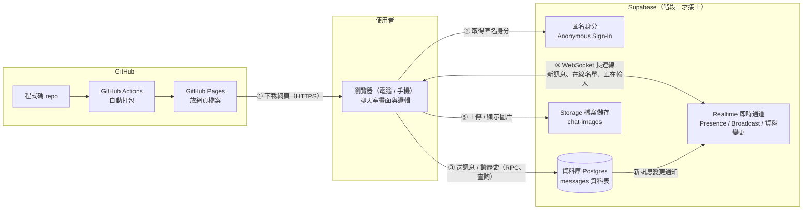
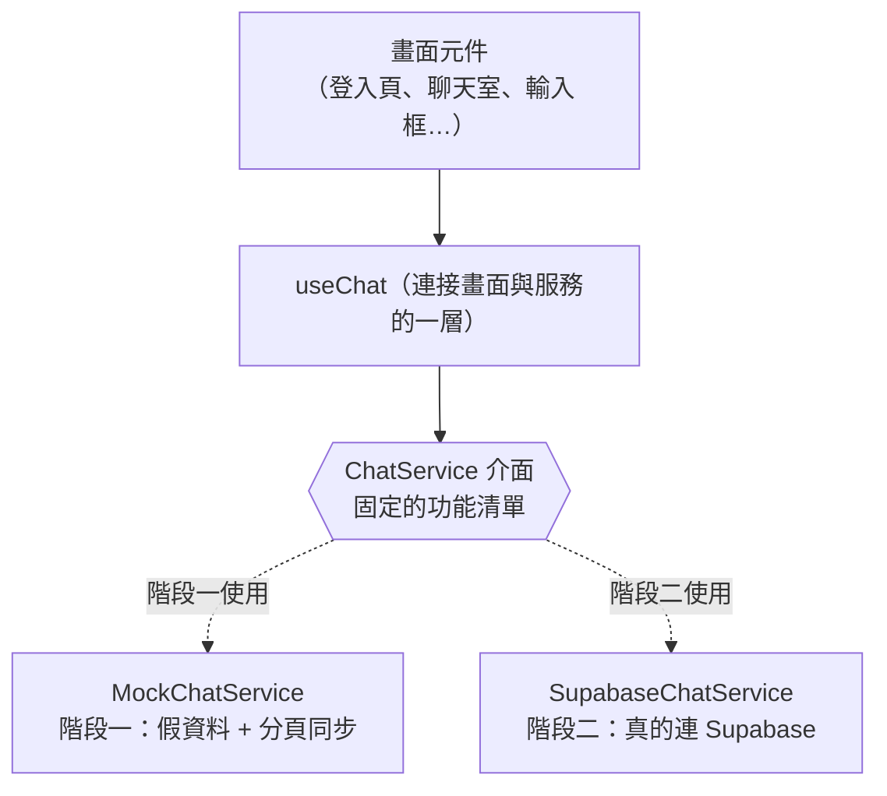
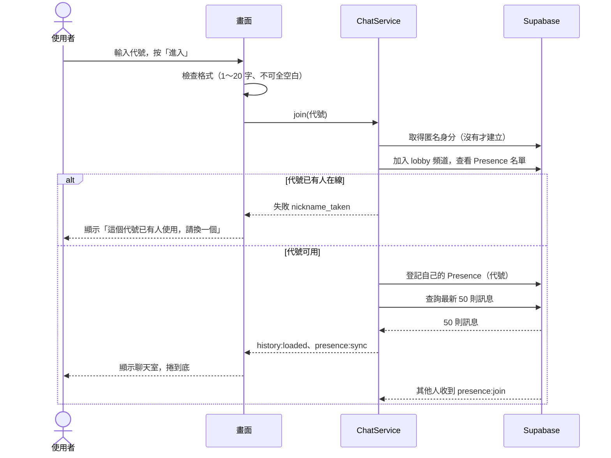
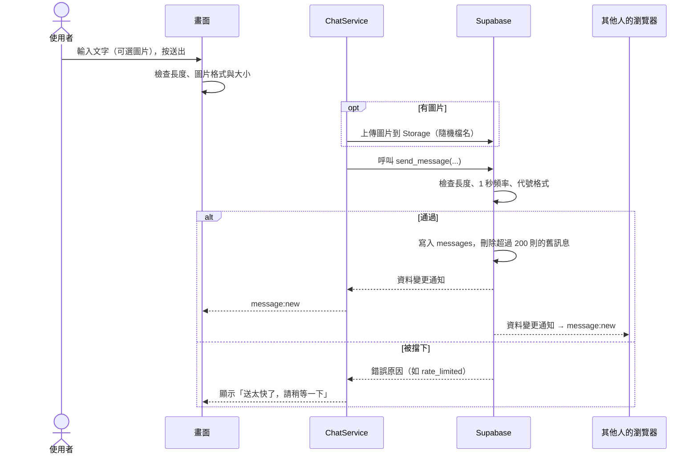
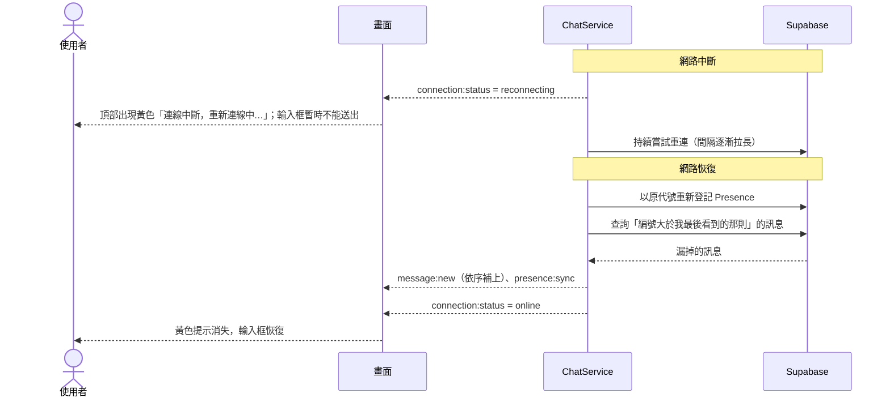
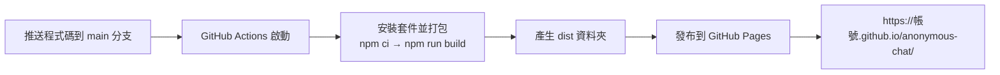

# 匿名聊天室 架構文件

> 讀者：不寫程式、但要做決定的專案負責人。
> 專有名詞第一次出現時，會用一句話解釋。
> 本文件只規劃，還沒有寫任何程式。

---

## 1. 專案說明與目標

**這是什麼**：一個不用註冊、不用登入的匿名聊天室。所有人都在同一個聊天室裡，只要知道網址，用電腦或手機都能進來。

**使用流程**：

1. 打開網頁
2. 輸入一個代號（暱稱）
3. 進入聊天室，看到最近 50 則訊息，也能送出訊息
4. 畫面上看得到誰在線上、有人進來或離開的提示、每則訊息的代號和時間

**目標**：

- 做出一個免費、能公開使用的聊天室
- 先把畫面做好、放上網路讓人看得到（階段一），最後才接上即時傳訊服務（階段二）
- 接上服務時，畫面部分幾乎不用重寫

**已經談定的產品規則**（整理自需求訪談）：

| 項目 | 規則 |
|---|---|
| 代號重複 | 已有人在線上用同一個代號時，擋下來要求換一個；對方離線後代號可再使用 |
| 歷史訊息 | 新進來的人看到最近 50 則 |
| 訊息長度與送出 | 最多 500 字；電腦按 Enter 送出、Shift+Enter 換行；手機按送出按鈕 |
| 時間顯示 | 只顯示「時:分」，用每個人自己裝置的時區；跨日時加日期分隔線 |
| 進出提示 | 訊息流中插入灰色小字，例如「小明 進來了」，不存檔 |
| 在線名單 | 電腦放在旁邊；手機頂部顯示「N 人在線」，點開展開名單 |
| 斷線 | 顯示黃色提示並自動重連，補回漏掉的訊息，代號保留 |
| 捲動 | 停在底部時自動捲到最新；往上翻舊訊息時不打斷，改顯示「↓ 有新訊息」按鈕 |
| 防洗版 | 每人 1 秒最多 1 則；沒有舉報、封鎖、刪除功能 |

> **需要你確認的一點**：訪談時我們談的是「訊息一直保留」（Q3），但你這次的指示寫「保留 200 則」要在資料庫強制執行。本文件**以 200 則為準**：資料庫只保留最近 200 則，更舊的自動刪除；新進來的人只載入其中最新的 50 則。如果你其實想要「永久保留」，只要拿掉第 9 章的自動刪除規則即可，其他不受影響。

---

## 2. 整體架構圖

先用白話說明三個角色：

- **瀏覽器**：使用者手上的 Chrome、Safari 等。聊天室的畫面和操作邏輯，都在這裡執行。
- **GitHub Pages**：GitHub 提供的免費網頁空間。它只負責「把網頁檔案送給瀏覽器」，自己不處理任何聊天內容。
- **Supabase**：一個免費的後端服務（幫你保管資料、即時轉送訊息的雲端服務），聊天內容都經過它。



**怎麼讀這張圖**：

1. 使用者輸入網址，GitHub Pages 把網頁檔案交給瀏覽器（①）。之後 GitHub Pages 就沒事了，不參與聊天。
2. 網頁在瀏覽器裡跑起來，再直接跟 Supabase 說話（②～⑤）。
3. **WebSocket** 是一種讓瀏覽器和伺服器保持「一直連著」的通道，伺服器有新東西可以立刻推給你，不用你一直問「有新訊息嗎」。即時聊天靠的就是它（④）。

**階段一**只有左半邊（瀏覽器 + GitHub Pages），沒有 Supabase；**階段二**才接上右邊。

---

## 3. 技術選擇

每一項都寫「選了什麼」和「為什麼」。

### 3.1 前端

| 項目 | 選了什麼 | 為什麼 |
|---|---|---|
| 程式語言 | **TypeScript** | 它是 JavaScript（網頁唯一通用的語言）加上「型別檢查」。型別檢查會在寫程式時就抓出拼錯欄位名稱這類錯誤。本專案的「通訊約定」（第 5 章）有很多固定格式的資料，用 TypeScript 可以讓電腦幫忙檢查格式有沒有寫錯，對不寫程式的你、以及幫你寫程式的 AI 都比較安全。 |
| 前端框架 | **React** | 框架是「蓋網頁畫面的工具箱」。聊天室的畫面會一直變（新訊息、人進出、正在輸入），React 的做法是「資料變了，畫面自動跟著變」，很適合。它是最普遍的框架，遇到問題最容易找到解答，AI 工具對它也最熟。 |
| 打包工具 | **Vite** | 把我們寫的許多程式檔，整理成瀏覽器能讀的幾個檔案（這個動作叫「打包」），也提供開發時的即時預覽。它快、設定少，並且有現成的 GitHub Pages 部署做法。 |
| 樣式 | 先不指定 | 顏色、字體、版面是 `/design` 和 `/frontend-design` 的工作。架構只要求：畫面元件和樣式分開放，方便之後替換。 |
| emoji 面板 | 使用現成的 emoji 選擇器套件（例如 `emoji-picker-element`） | 自己做分類、搜尋、各系統顯示都很費工。現成套件已處理好，只需要接上「點選後插入輸入框」的行為。 |

### 3.2 Supabase 用哪些功能

| 需求 | 用 Supabase 的哪個功能 | 為什麼 |
|---|---|---|
| 訊息要存起來、新進來的人看歷史 | **Database（Postgres 資料庫）** | 資料庫就是一個可靠的「表格櫃」。把每則訊息存成一列，新進來的人查最新 50 列即可。 |
| 新訊息即時出現在所有人畫面 | **Realtime 的「資料變更通知」（Postgres Changes）** | 資料表一有新的一列，Supabase 就透過 WebSocket 通知所有已連線的瀏覽器。這樣「存起來」和「廣播出去」是同一件事，不會出現「廣播了但沒存到」的矛盾。 |
| 誰在線上、進來離開的提示 | **Realtime 的 Presence（在線狀態）** | Presence 專門追蹤「現在有哪些連線」，有人加入或斷線，會自動通知大家。不用我們自己做「心跳」（定時回報我還活著）。 |
| 「正在輸入…」 | **Realtime 的 Broadcast（廣播）** | 這是即時、用完即丟的訊號，不需要存進資料庫，Broadcast 正好是「只轉送、不存檔」。 |
| 傳圖片 | **Storage（檔案儲存）** | 圖片不適合塞進資料庫。Storage 專門放檔案，並可設定「只收哪些格式、最大多大」。資料庫的訊息只記錄圖片的路徑。 |
| 辨識「這是同一個人」，用來做防洗版 | **Anonymous Sign-In（匿名登入）** | 使用者不用註冊也不用輸入任何東西，Supabase 會自動給每個瀏覽器一個隨機身分編號。這個編號讓伺服器能判斷「同一個人 1 秒內送了兩則」，同時符合「不需要登入」。 |
| 在伺服器強制規則（長度、頻率、保留數量） | **Postgres 函式（RPC）與觸發器、RLS** | 見下方說明。 |

**三個名詞說明**：

- **RPC（遠端函式呼叫）**：瀏覽器不直接寫資料庫，而是呼叫一個我們事先寫好的函式（例如 `send_message`）。函式裡面會先檢查規則再寫入。
- **觸發器（Trigger）**：資料庫在某件事發生後自動執行的一段規則，例如「每次新增訊息後，自動刪掉第 200 則以前的」。
- **RLS（Row Level Security，列級安全）**：資料庫的權限規則，決定「誰能讀、誰能寫哪些列」。沒有開 RLS，任何人都可以亂改整張表，所以一定要開。

> **為什麼規則要放在伺服器端，不能只靠前端擋？** 前端的檢查（例如輸入超過 500 字就不給送）只是為了使用者體驗。懂技術的人可以繞過網頁，直接對 Supabase 發請求。所以真正能保證規則的，只有伺服器端（資料庫）。前端擋是「禮貌提醒」，伺服器擋才是「真的鎖門」。

---

## 4. 兩個階段

### 階段一：還沒接 Supabase

**目標**：先把完整的畫面和操作流程做出來，放到 GitHub Pages，讓你和別人能點開看、用手機試。

**前端能做到的程度**：

| 功能 | 階段一的做法 |
|---|---|
| 輸入代號、進入聊天室 | 完整可用（包含格式檢查） |
| 看到歷史訊息 | 使用預先寫好的 50 則假訊息 |
| 送出訊息、顯示代號與時間 | 可用；訊息只存在這個瀏覽器 |
| 在線名單、進出提示 | 顯示幾位「機器人」假使用者，並會隨機進出，用來看提示效果 |
| 代號重複擋下 | 與目前在線的機器人、以及同一台電腦的其他分頁比對 |
| 正在輸入 | 機器人會偶爾顯示「正在輸入…」 |
| emoji 面板 | 完整可用 |
| 傳圖片 | 可選圖、預覽、格式與大小檢查、點擊放大；圖片只在本機顯示，不會上傳 |
| 斷線提示 | 提供一個隱藏的測試按鈕，模擬斷線與重連 |
| 同一台電腦開兩個分頁 | 兩個分頁可以互相聊天（用瀏覽器內建的 BroadcastChannel 同步），可以親眼看到雙人對話 |
| 手機與電腦版面 | 完整可用，這是階段一最重要的驗收重點 |

**階段一做不到的**：真的跨裝置聊天（你的手機和電腦互相傳訊）、訊息長久保存、真正的防洗版與伺服器端規則。這些要等階段二。

**怎麼在 GitHub Pages 看到效果**：把程式碼推上 GitHub，一個自動流程（GitHub Actions）會幫你打包並發布，之後網址是 `https://<你的帳號>.github.io/anonymous-chat/`。詳見第 12 章。

### 階段二：接上 Supabase 之後的改變

| 項目 | 改變 |
|---|---|
| 訊息來源 | 假資料換成 Supabase 資料庫的真訊息 |
| 在線名單 | 機器人換成真實連線（Presence） |
| 正在輸入 | 機器人換成真實使用者的 Broadcast |
| 圖片 | 從「只在本機顯示」變成「上傳到 Storage，所有人看得到」 |
| 防洗版、長度限制、保留 200 則 | 在資料庫強制執行 |
| 設定 | 多了 Supabase 的網址與公開金鑰（第 8 章） |

**畫面完全不用動。** 改變只發生在「資料從哪裡來」這一層。

### 兩個階段之間：怎麼設計才不用整個重寫

做法是在畫面和資料來源之間，放一個**固定的介面（合約）**，叫做 `ChatService`。



- **畫面**只認識 `ChatService` 這份「功能清單」：`加入聊天室`、`送出訊息`、`通知正在輸入`、`上傳圖片`、`離開`，以及它會發出的事件（第 5 章）。畫面完全不知道背後是假資料還是 Supabase。
- 階段一寫 `MockChatService`，階段二寫 `SupabaseChatService`，兩者**說一樣的話**。
- 用一個設定值 `VITE_BACKEND`（`mock` 或 `supabase`）決定啟動哪一個。切換時不用改任何畫面程式。
- 好處：階段二如果 Supabase 還沒設定好，隨時可以切回 `mock` 繼續做畫面。

> 這個「合約」就是第 5 章的內容。**先把第 5 章定死，兩邊才接得起來。**

---

## 5. 通訊約定

這一章是「畫面」和「資料來源」之間的約定：有哪些事件、資料長什麼樣子。階段一的假服務和階段二的 Supabase 都必須遵守同一份。

### 5.1 資料格式

**訊息（Message）**

| 欄位 | 型別 | 說明 |
|---|---|---|
| `id` | 數字（遞增） | 訊息編號，由資料庫產生；用來排序、補漏掉的訊息 |
| `nickname` | 文字 | 發送者代號（1～20 字） |
| `body` | 文字 | 訊息內容（0～500 字；有圖片時可以為空） |
| `imagePath` | 文字或空值 | 圖片在 Storage 的路徑；沒有圖片就是空 |
| `createdAt` | 時間（ISO 8601） | 伺服器收到的時間（用伺服器時間，不信任使用者裝置的時間） |

**在線者（Member）**

| 欄位 | 型別 | 說明 |
|---|---|---|
| `nickname` | 文字 | 代號 |
| `joinedAt` | 時間 | 進入時間 |

**系統提示（SystemNotice）**——只存在畫面上，不存資料庫

| 欄位 | 型別 | 說明 |
|---|---|---|
| `kind` | `"join"` 或 `"leave"` | 進來或離開 |
| `nickname` | 文字 | 是誰 |
| `at` | 時間 | 發生時間 |

**連線狀態（ConnectionStatus）**：`"connecting"`（連線中）、`"online"`（已連線）、`"reconnecting"`（重連中）、`"offline"`（已中斷）。

### 5.2 事件名稱

**A. 畫面對服務下指令**（畫面 → 服務）

| 指令 | 帶什麼 | 結果 |
|---|---|---|
| `join(nickname)` | 代號 | 成功：進入聊天室；失敗：回傳原因（`nickname_taken` 代號被用、`nickname_invalid` 格式不合） |
| `sendMessage({ body, image? })` | 文字、可選的圖片檔 | 成功或失敗原因（`too_long`、`rate_limited`、`image_type`、`image_too_large`、`offline`） |
| `setTyping(isTyping)` | 是否正在輸入 | 不回傳結果 |
| `leave()` | 無 | 離開聊天室 |

**B. 服務通知畫面**（服務 → 畫面）

| 事件名稱 | 帶什麼 | 什麼時候發生 |
|---|---|---|
| `history:loaded` | 最新 50 則 `Message[]` | 剛進入或重連補資料時 |
| `message:new` | `Message` | 有任何人（包含自己）送出新訊息 |
| `presence:sync` | `Member[]` | 在線名單有變，整份更新 |
| `presence:join` | `Member` | 有人進來（用來產生「進來了」提示） |
| `presence:leave` | `Member` | 有人離開（用來產生「離開了」提示） |
| `typing:update` | 正在輸入的代號 `string[]` | 輸入狀態改變（已排除自己） |
| `connection:status` | `ConnectionStatus` | 連線狀態改變 |

### 5.3 Supabase 對應（階段二用）

| 約定 | Supabase 做法 |
|---|---|
| `history:loaded` / `message:new` | 查詢 `messages` 資料表最新 50 筆；訂閱該表的新增事件 |
| `sendMessage` | 呼叫資料庫函式 `send_message(nickname, body, image_path)` |
| `presence:*` | Realtime 的 Presence，頻道名稱 `lobby` |
| `typing:update` | Realtime 的 Broadcast，事件名稱 `typing`，內容 `{ nickname, isTyping }` |
| 圖片 | 上傳到 Storage bucket（儲存桶）`chat-images`，檔名為隨機 UUID |

---

## 6. 資料流

### 6.1 進入聊天室



### 6.2 送出訊息



### 6.3 離開

- **主動離開**（關閉分頁、按離開）：瀏覽器告知 Supabase 取消 Presence，其他人收到 `presence:leave`，畫面插入「某某 離開了」。
- **直接關掉、沒電、網路突然斷**：瀏覽器來不及告知。Supabase 偵測到連線消失（約數十秒內），自動視為離開，結果相同，只是稍有延遲。
- 離開後，該代號立刻釋出，其他人可以使用。

### 6.4 斷線重連



**重點**：

- 重連時用「最後看到的訊息編號」去補，所以不會重複也不會漏。
- 代號保留在瀏覽器（本次分頁記憶中），不用重新輸入。
- 若斷線太久、對方的 Presence 已被視為離開，而代號此時恰好被別人拿走：回到代號輸入頁，提示「代號已被使用，請換一個」。這是少見情況，接受這樣處理。
- 若斷線期間漏掉超過 200 則（資料庫已刪掉）：只補得到仍保留的訊息，畫面直接重新載入最新 50 則。

---

## 7. 畫面清單

只規定「有什麼元素、做什麼事」，不規定顏色和樣式。

### 7.1 畫面一：進入頁

| 元素 | 行為 |
|---|---|
| 標題與一句說明 | 純文字 |
| 代號輸入框 | 限制 1～20 字；按 Enter 等同按「進入」 |
| 「進入」按鈕 | 代號不合格時不能按；按下後顯示「連線中…」 |
| 錯誤訊息區 | 顯示「代號已有人使用，請換一個」、「代號格式不正確」、「無法連線」等 |

### 7.2 畫面二：聊天室

整體分為：頂部列、在線名單、訊息區、輸入區。電腦版名單在右側；手機版名單收進頂部。

**頂部列**

| 元素 | 行為 |
|---|---|
| 聊天室名稱 | 純文字 |
| 「N 人在線」（手機） | 點一下展開／收合名單 |
| 連線狀態條 | 平時隱藏；斷線時顯示黃色「連線中斷，重新連線中…」，恢復後消失 |
| 「離開」按鈕 | 離開並回到進入頁 |

**在線名單**

| 元素 | 行為 |
|---|---|
| 代號清單 | 即時更新；自己的代號有標示（例如「（你）」） |
| 人數 | 即時更新 |

**訊息區**

| 元素 | 行為 |
|---|---|
| 訊息（一則） | 顯示代號、「時:分」、內容；有圖片就顯示縮小的圖；自己的訊息與別人的有所區別 |
| 日期分隔線 | 兩則訊息跨日時出現 |
| 系統提示 | 灰色小字「某某 進來了／離開了」，插在訊息流中；不存檔，重新整理就消失 |
| 圖片縮圖 | 點一下開啟放大檢視 |
| 「↓ 有新訊息」按鈕 | 只在使用者往上翻舊訊息、同時有新訊息時顯示；點了跳到最底 |
| 自動捲動規則 | 停在底部時，新訊息自動捲到底；往上翻時不打斷；自己送出時一律捲到底 |

**正在輸入提示**（輸入框上方）

| 情況 | 顯示 |
|---|---|
| 1～3 人 | 「小明 正在輸入…」、「小明、小華 正在輸入…」 |
| 超過 3 人 | 「多人正在輸入…」 |
| 消失時機 | 對方停止打字約 3 秒，或對方送出訊息後立刻消失；不顯示自己 |

**輸入區**

| 元素 | 行為 |
|---|---|
| 文字輸入框 | 最多 500 字，接近上限時顯示剩餘字數；電腦 Enter 送出、Shift+Enter 換行；手機 Enter 為換行，用按鈕送出 |
| 😀 emoji 按鈕 | 開啟 emoji 面板；點選後插入輸入框游標位置，面板繼續開著；再按一次按鈕或點面板外關閉 |
| 🖼 圖片按鈕 | 開啟選檔（手機可選相簿或拍照）；選好後在輸入框上方出現縮圖與「取消」按鈕 |
| 圖片錯誤訊息 | 格式不對或超過 5 MB 時顯示在輸入框上方，不送出 |
| 送出按鈕 | 文字與圖片皆空時不能按；送出中暫時停用 |
| 頻率錯誤訊息 | 「送太快了，請稍等一下」 |
| 斷線時 | 輸入框與送出按鈕暫停使用，提示原因 |

### 7.3 畫面三：圖片放大檢視

| 元素 | 行為 |
|---|---|
| 放大的圖片 | 完整顯示，依螢幕縮放 |
| 關閉 | 按「關閉」按鈕、點圖片或空白處、按 Esc 鍵都能關閉 |

---

## 8. 金鑰

「金鑰」是一段長長的字串，像是通行證，證明「你有權限使用這個 Supabase 專案」。這個專案會碰到的有：

| 項目 | 是什麼 | 能公開嗎 | 放在哪 |
|---|---|---|---|
| **Project URL** | 你的 Supabase 專案網址（`https://xxxx.supabase.co`） | 可以公開 | 前端設定 |
| **Publishable key**（公開金鑰；舊版介面叫 `anon key`） | 給網頁用的金鑰，權限很小，只能做資料庫規則（RLS）允許的事 | **可以公開**。它本來就會被打包進網頁，任何人用瀏覽器都看得到 | 前端設定 |
| **Secret key**（私密金鑰；舊版叫 `service_role key`） | 萬能鑰匙，可以**繞過所有資料庫權限規則**，讀寫、刪除全部資料 | **絕對不能公開**，前端與 repo 都不能出現 | 本專案**完全用不到**，也不要複製到任何地方 |
| **資料庫密碼** | 建立專案時設定的密碼，可直接連進資料庫 | **絕對不能公開** | 只存在你自己的密碼管理工具；本專案的網站程式用不到 |
| **Access Token**（個人存取權杖） | 讓命令列工具操作你的 Supabase 帳號 | **絕對不能公開** | 只有在用命令列工具時才需要，放在你自己的電腦環境變數，不放進 repo |

**為什麼公開金鑰可以公開？** 因為網頁是在使用者的瀏覽器裡執行，瀏覽器必須拿到這把金鑰才能連線，所以沒有任何辦法把它藏起來。安全靠的不是「藏金鑰」，而是**資料庫那邊的規則（RLS、函式）**：就算有人拿到公開金鑰，也只能做規則允許的事。這也是第 3、9 章一再強調「規則要放在伺服器端」的原因。

### 怎麼產生

1. 登入 Supabase 網站，建立一個新專案（Project）
2. 進入專案的 **Settings → API Keys**（或 API）頁面
3. 複製 **Project URL** 與 **Publishable key**（舊介面為 `anon public`）
4. **不要**複製 Secret key / `service_role`

### 放在哪裡

| 場合 | 位置 | 說明 |
|---|---|---|
| 在自己電腦開發 | 專案根目錄的 `.env.local` 檔 | 此檔列在 `.gitignore`，不會被 commit |
| 給別人參考格式 | `.env.example` | 只放變數名稱和假值，**可以** commit |
| 發布到 GitHub Pages | GitHub repo 的 **Settings → Secrets and variables → Actions**（建議放 Variables 或 Secrets 皆可） | 自動打包時才注入，不寫在程式碼裡 |

需要的變數：

```
VITE_BACKEND=supabase              # 階段一用 mock
VITE_SUPABASE_URL=https://xxxx.supabase.co
VITE_SUPABASE_PUBLISHABLE_KEY=sb_publishable_xxxxxxxx
```

> 注意：放在 GitHub Secrets 並不代表打包完的網頁看不到它。公開金鑰終究會出現在網頁檔案裡，這是正常的。放 Secrets 只是為了「不要寫死在程式碼、方便更換」，不是為了保密。

### 怎麼避免被 commit 到 GitHub

1. **`.gitignore` 先寫好**：包含 `.env`、`.env.local`、`.env.*.local`，並在建立任何 `.env` 檔之前就先寫入
2. **只 commit `.env.example`**，裡面只放假值
3. **開啟 GitHub 的 Secret scanning 與 Push protection**（repo 的 Settings → Code security）：萬一誤貼金鑰，推送時會被攔下並警告
4. **commit 前檢查**：用 `git status` 確認 `.env.local` 沒有出現在待提交清單
5. **萬一洩漏**：到 Supabase 的 API Keys 頁面立刻重新產生（rotate）該金鑰，舊的就失效；只洩漏公開金鑰則影響有限，但洩漏 Secret key 或資料庫密碼要立即更換

---

## 9. 安全與限制

### 9.1 別人可能送什麼奇怪的東西

這裡分「前端擋」（使用者體驗、第一道）與「伺服器擋」（真正的保證、第二道）。

| 威脅 | 前端怎麼擋 | 伺服器怎麼擋 |
|---|---|---|
| **塞入網頁程式碼**（例如訊息寫 `<script>…`，想讓別人的瀏覽器執行；這叫 XSS） | 所有訊息與代號一律當成**純文字**顯示，絕不當成網頁語法解析（React 預設就是這樣，禁止使用 `dangerouslySetInnerHTML`） | 不需要額外處理，因為資料只當文字存放 |
| **超長訊息** | 超過 500 字不給送 | `send_message` 函式與資料表欄位限制都檢查 500 字 |
| **洗版**（連續狂送） | 送出後短暫停用按鈕、顯示「送太快了」 | `send_message` 檢查同一匿名身分最近一則訊息是否在 1 秒內，是就拒絕 |
| **怪代號**（全空白、控制字元、超長、假裝成系統） | 輸入時即時檢查；禁止代號為「系統」、「admin」等保留字 | 函式也檢查：1～20 字、去除前後空白、不含控制字元 |
| **冒用別人代號** | 加入前比對 Presence 名單 | 見下方 9.2 的「已知限制」 |
| **假圖片**（改副檔名的程式、檔案過大、SVG 內含程式碼） | 只收 JPG、PNG、GIF、WebP；不收 SVG；檢查檔案內容類型（不只看副檔名）與 5 MB 上限 | Storage 儲存桶設定只允許那四種類型、單檔上限 5 MB；檔名由系統改成隨機 UUID，使用者提供的檔名不會被採用 |
| **圖片網址亂指**（`imagePath` 指向別的地方） | 只顯示 `chat-images` 內的路徑 | 函式檢查 `image_path` 必須符合我們自己的路徑格式 |
| **直接打 API 繞過網頁** | 無法防止 | 所有寫入只允許走 `send_message` 函式；`messages` 資料表**不開放**直接新增／修改／刪除；RLS 全部開啟 |
| **偽造「正在輸入」** | 只顯示最多 3 人名字 | 這是低風險的暫時訊號，不存檔，接受之 |
| **批量建立匿名身分來繞過頻率限制** | 無 | Supabase 對匿名登入有每個網路位址的次數上限；本版不加驗證碼，見第 10 章 |

### 9.2 已知限制（誠實說明）

- **代號唯一是「盡力而為」**：因為沒有登入，代號唯一性是靠 Presence 名單比對。兩個人在同一瞬間搶同一個代號時，理論上可能同時成功。出現時畫面上會有兩個同名者。本版接受此風險，不另外做複雜的伺服器端配對。
- **訊息上的代號是使用者自填的**：沒有帳號就無法證明「這個人真的是他」。這是匿名聊天室本來的特性。
- **沒有內容審查**：不過濾髒話或不當內容，也沒有刪除功能（見第 10 章）。
- **圖片所有人都能直接看**：Storage 儲存桶設為公開讀取，知道圖片網址的人都能開啟（網址是隨機的，不易猜）。請不要在這個聊天室傳敏感圖片。

### 9.3 免費方案上限

> 以下數字是依我所知的免費方案內容整理，**Supabase 和 GitHub 會調整方案，上線前請到官方價格頁再確認一次**。

| 服務 | 要注意的上限 | 對本專案的影響 |
|---|---|---|
| Supabase：資料庫容量 | 約 500 MB | 訊息只保留 200 則，文字佔用極小，不是問題 |
| Supabase：檔案儲存 | 約 1 GB 總量；單檔受設定上限約束 | **最容易先滿的是圖片**。5 MB × 很多張會快速累積；本版不自動清圖片（見第 10 章），需要定期留意用量 |
| Supabase：流量 | 每月有出站流量上限（約數 GB） | 圖片被反覆載入最耗流量；縮圖顯示、點開才載入大圖可節省 |
| Supabase：Realtime 同時連線數 | 免費方案約 200 條 | 同時在線超過約 200 人時，新的人可能連不上 |
| Supabase：Realtime 訊息頻率 | 每秒有上限 | 「正在輸入」要節流（見下） |
| Supabase：閒置暫停 | 專案**一週沒有活動會被自動暫停**，要到後台手動恢復 | 久沒人用之後打開可能連不上，要先去 Supabase 網站按恢復 |
| Supabase：匿名登入 | 每個網路位址每小時有建立次數上限 | 同一個學校或公司網路下，多人同時第一次進入可能被限制 |
| GitHub Pages | 網站約 1 GB、每月約 100 GB 流量（參考值） | 本專案很小，不是問題 |
| GitHub Pages：私有 repo | 免費帳號的 Pages 通常需要 public repo | 因此 repo 會是公開的，這也是第 8 章金鑰規則要嚴格的原因 |

**節流（throttle）**：「正在輸入」不要每打一個字就發一次，而是「開始打字時發一次，之後每 2 秒最多再發一次」，停止後 3 秒自動取消。這樣可省下很多 Realtime 額度。

---

## 10. 這一版刻意不做的事

| 不做 | 為什麼 |
|---|---|
| 註冊、登入、帳號 | 需求明確寫「不需要」。匿名身分只用來做防洗版，使用者看不到 |
| 私訊 | 需求明確寫「不需要」 |
| 舉報、封鎖、刪除訊息、管理員 | 沒有登入就沒有管理者身分，做了反而造成「誰都能刪」的風險；先以頻率限制擋住最基本的洗版 |
| 內容過濾（髒話、廣告） | 規則難以做對、容易誤判；先觀察實際使用狀況再說 |
| 代號的嚴格唯一保證 | 需要額外的伺服器端心跳機制，複雜度高；本版用 Presence 盡力而為（見 9.2） |
| 多個聊天室／房間 | 需求是「所有人在同一個聊天室」 |
| 訊息編輯、回覆、引用、已讀 | 不在需求內，先求簡單 |
| 一則多張圖片 | 訪談時決定一則一張，畫面與儲存都單純 |
| 圖片自動清理 | 訊息被刪（超過 200 則）後，Storage 裡的圖片檔會留著。要清理需要另外寫定時任務，等實際用量逼近上限再做 |
| 驗證碼（CAPTCHA）防機器人 | 會增加使用者步驟；先依賴 Supabase 內建的匿名登入次數限制 |
| 推播通知、離線通知 | 不在需求內 |
| 進出提示的歷史 | 進出提示不存檔，新進來的人看不到之前誰進出過（訪談已決定） |
| 多語系、深色模式切換 | 不在需求內；樣式交給 `/design` 決定 |
| 自動化的端對端測試 | 先以驗證清單（第 13 章）手動確認；專案穩定後再補 |

---

## 11. Repo 的資料夾結構

「Repo」就是放這個專案所有檔案的資料夾（GitHub 上的儲存庫）。

```
anonymous-chat/
├─ .github/
│  └─ workflows/
│     └─ deploy.yml            # 自動打包並發布到 GitHub Pages 的流程
├─ docs/
│  ├─ requirements.md          # 需求說明
│  └─ architecture.md          # 本文件
├─ supabase/                   # 階段二才會有
│  └─ migrations/
│     ├─ 001_messages.sql      # 建立 messages 資料表、RLS、保留 200 則的觸發器
│     ├─ 002_send_message.sql  # send_message 函式（長度、頻率、代號檢查）
│     └─ 003_storage.sql       # chat-images 儲存桶與上傳規則
├─ public/                     # 原樣複製的靜態檔（網站圖示等）
├─ src/
│  ├─ main.tsx                 # 程式入口
│  ├─ App.tsx                  # 決定顯示進入頁或聊天室
│  ├─ types.ts                 # 第 5 章的資料格式（Message、Member…）
│  ├─ config.ts                # 讀取 VITE_ 開頭的設定值
│  ├─ services/
│  │  ├─ ChatService.ts        # 介面：第 5 章的指令與事件（兩階段共用的合約）
│  │  ├─ MockChatService.ts    # 階段一：假資料、機器人、分頁同步
│  │  ├─ SupabaseChatService.ts# 階段二：真正連線 Supabase
│  │  └─ createChatService.ts  # 依 VITE_BACKEND 決定用哪一個
│  ├─ hooks/
│  │  └─ useChat.ts            # 把服務的事件變成畫面可用的狀態
│  ├─ components/
│  │  ├─ JoinPage/             # 進入頁
│  │  ├─ ChatRoom/             # 聊天室外框、頂部列
│  │  ├─ MemberList/           # 在線名單
│  │  ├─ MessageList/          # 訊息區、日期分隔線、系統提示、新訊息按鈕
│  │  ├─ MessageInput/         # 輸入框、送出
│  │  ├─ EmojiPicker/          # emoji 面板
│  │  ├─ ImagePicker/          # 選圖、預覽
│  │  ├─ ImageViewer/          # 放大檢視
│  │  ├─ TypingIndicator/      # 正在輸入提示
│  │  └─ ConnectionBanner/     # 斷線黃色提示
│  ├─ lib/
│  │  ├─ validate.ts           # 代號、訊息、圖片的檢查規則
│  │  └─ time.ts               # 時間與日期分隔線的格式化
│  └─ styles/                  # 樣式（由 /design 與 /frontend-design 產出）
├─ .env.example                # 設定值範本（只有假值，可 commit）
├─ .gitignore                  # 含 .env、.env.local、node_modules、dist
├─ index.html
├─ package.json
├─ tsconfig.json
├─ vite.config.ts              # 含 base: '/anonymous-chat/'
└─ README.md                   # 專案簡介與啟動方式
```

**設計重點**：`services/` 資料夾是唯一「知道後端是什麼」的地方；`components/` 只負責畫面。

---

## 12. 部署到 GitHub Pages 的方式

### 一次性設定

1. 在 GitHub 建立 repo，名稱 `anonymous-chat`，設為 **Public**（免費 Pages 的需求）
2. Repo 的 **Settings → Pages**，Source（來源）選 **GitHub Actions**
3. 開啟 **Secret scanning** 與 **Push protection**（見第 8 章）
4. 階段二時，到 **Settings → Secrets and variables → Actions** 新增 `VITE_BACKEND`、`VITE_SUPABASE_URL`、`VITE_SUPABASE_PUBLISHABLE_KEY`

### 每次發布



- 你只需要把程式推上 `main` 分支，後面全自動，約 1～2 分鐘後網址就會更新
- **網址路徑**：因為網站在 `/anonymous-chat/` 這個子路徑下，打包設定必須寫 `base: '/anonymous-chat/'`，否則網頁會找不到自己的檔案而一片空白（這是 GitHub Pages 最常見的新手問題）
- **階段一** 的發布不需要任何金鑰，`VITE_BACKEND` 預設為 `mock`
- **階段二** 切換只需新增上述三個設定值再重新發布，不用改畫面程式

---

## 13. 驗證清單

### 階段一（前端 + 假服務，在 GitHub Pages 上驗收）

**部署**

- [ ] 推送後 GitHub Actions 成功完成
- [ ] 開啟 GitHub Pages 網址，不是空白頁，也沒有找不到檔案的錯誤
- [ ] 重新整理頁面仍正常

**進入頁**

- [ ] 代號空白、全空白、超過 20 字時，不能進入並顯示提示
- [ ] 輸入與機器人相同的代號，被擋下並顯示「已有人使用」
- [ ] 輸入有效代號，進入聊天室並看到 50 則歷史訊息，畫面停在底部

**聊天室**

- [ ] 送出訊息後立即出現，顯示自己的代號與「時:分」
- [ ] 訊息超過 500 字不能送出；接近上限有字數提示
- [ ] 電腦：Enter 送出、Shift+Enter 換行；手機：Enter 換行、按鈕送出
- [ ] 跨日訊息之間有日期分隔線
- [ ] 機器人進出時，訊息流出現灰色「進來了／離開了」提示，名單同步更新
- [ ] 重新整理後，進出提示不會留下
- [ ] 同一台電腦開兩個分頁，用不同代號可以互相聊天；第二個分頁用相同代號會被擋
- [ ] 關掉其中一個分頁，另一個看到「離開了」，且該代號可以再被使用
- [ ] 正在輸入：機器人輸入時顯示名字；3 人以上顯示「多人正在輸入…」；停止後消失
- [ ] emoji：面板可開關、分類顯示；點選後插入游標位置；面板繼續開著
- [ ] 圖片：可選圖、顯示縮圖預覽、可取消；送出後訊息中有縮圖；點擊可放大並能用三種方式關閉
- [ ] 圖片：選 SVG 或 PDF、選超過 5 MB 的檔案，會顯示錯誤且不送出
- [ ] 圖片與文字可同時送出；只有圖片也能送出
- [ ] 往上翻舊訊息時，新訊息進來不會被拉回底部，且出現「↓ 有新訊息」按鈕；點了跳到底
- [ ] 模擬斷線：出現黃色提示、輸入框停用；恢復後提示消失、輸入框恢復，代號保留

**版面**

- [ ] 手機寬度（約 375px）：沒有水平捲動、名單可點開展開、輸入區不被手機鍵盤蓋住
- [ ] 電腦寬度：名單在右側，內容不會過度拉寬
- [ ] 在真實手機（iOS 與 Android 各至少一支）上完成上述主要流程

**安全（前端）**

- [ ] 送出 `<script>alert(1)</script>` 與 ``，畫面以純文字顯示，沒有執行
- [ ] repo 中搜尋不到任何金鑰或 `.env.local`

### 階段二（接上 Supabase）

**設定**

- [ ] Supabase 專案建立完成；已開啟匿名登入（Anonymous Sign-Ins）
- [ ] 三份資料庫設定檔（migrations）已執行；`messages` 資料表已開啟 RLS
- [ ] 網站使用的是公開金鑰；repo 與打包後的網頁中找不到 Secret key 和資料庫密碼
- [ ] `.env.local` 沒有出現在 `git status`；`.env.example` 只有假值

**即時聊天（兩台不同裝置）**

- [ ] 電腦與手機各自進入，互相能看到對方的訊息，延遲在 1～2 秒內
- [ ] 在線名單即時正確；一方關閉頁面後，另一方在數十秒內看到「離開了」
- [ ] 同代號第二個人（另一台裝置）被擋下
- [ ] 新進來的人看到最新 50 則歷史訊息
- [ ] 「正在輸入」跨裝置可顯示，且停止後會消失

**斷線重連**

- [ ] 手機切到飛航模式再關閉：出現黃色提示，恢復後自動補回漏掉的訊息，沒有重複也沒有遺漏，代號不變
- [ ] 斷線期間別人送的訊息，恢復後都補得回來

**圖片**

- [ ] 圖片成功上傳，另一台裝置能看到並點擊放大
- [ ] Storage 內的檔名是隨機 UUID，不是原檔名
- [ ] 直接對 Storage 上傳 SVG、或超過 5 MB 的檔案，被伺服器拒絕（不是只靠前端擋）

**伺服器端規則**（必須用繞過網頁的方式測，才算真的驗證）

- [ ] 直接呼叫 `send_message` 傳 501 字：被拒絕
- [ ] 同一身分 1 秒內連續呼叫兩次：第二次被拒絕
- [ ] 直接對 `messages` 資料表做 insert／update／delete：被拒絕
- [ ] 連續送出超過 200 則後，資料表中只剩最新 200 則
- [ ] 代號含控制字元、超過 20 字、保留字：被拒絕

**免費額度**

- [ ] 在 Supabase 後台確認目前資料庫、Storage 與 Realtime 的用量與免費上限
- [ ] 已記下「專案閒置一週會暫停」，並知道如何手動恢復

---

## 14. 新增功能

三項新增功能，以及各自的規則「在哪裡執行」。

| 功能 | 等級 | 做什麼 | 階段一 | 階段二 |
|---|---|---|---|---|
| **emoji 選單** | A | 輸入框旁的笑臉按鈕，開啟分類的 emoji 面板，點選後插入游標處，面板繼續開著 | 完整可用（純前端） | 不需改變（純前端，與 Supabase 無關） |
| **「正在輸入…」提示** | B | 其他人打字時，輸入框上方顯示名字；3 人以上顯示「多人」；停 3 秒或送出後消失 | 機器人模擬 | 用 Supabase Realtime Broadcast（不存檔），前端節流 |
| **傳圖片** | C | 一則一張，送出前預覽可取消；JPG／PNG／GIF／WebP，5 MB 內；點圖放大 | 只在本機顯示，不上傳 | 上傳到 **Supabase Storage**（儲存桶 `chat-images`），訊息記錄圖片路徑 |

### 規則在哪裡強制執行

| 規則 | 前端（提醒使用者） | 伺服器端／資料庫（真正強制） |
|---|---|---|
| **防洗版：每人 1 秒最多 1 則** | 送出後短暫停用，顯示提示 | ✅ **資料庫強制**：`send_message` 函式依匿名身分檢查上一則時間 |
| **保留最近 200 則** | 只顯示最新 50 則 | ✅ **資料庫強制**：新增訊息後，由觸發器自動刪除第 200 則以前的 |
| 訊息最多 500 字 | 超過不給送 | ✅ 資料庫強制（函式 + 欄位限制） |
| 代號 1～20 字與格式 | 即時檢查 | ✅ 資料庫強制（函式） |
| 圖片格式與 5 MB 上限 | 選檔時檢查 | ✅ Storage 儲存桶設定強制 |
| 代號不重複 | 比對 Presence 名單 | ⚠️ 盡力而為，不是嚴格保證（見 9.2） |
| 「正在輸入」節流與 3 秒消失 | ✅ 前端處理 | 無（暫時訊號，不重要） |

> 簡單記憶：**會影響資料正確性、會佔用空間、會被濫用的規則，都在資料庫鎖住；只影響操作手感的規則，放前端。**
